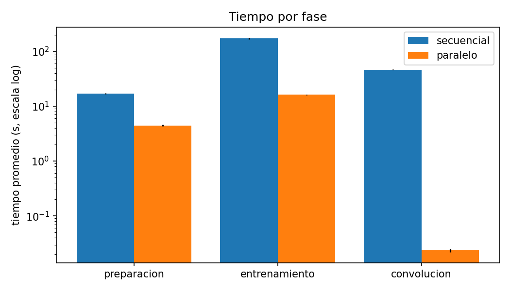
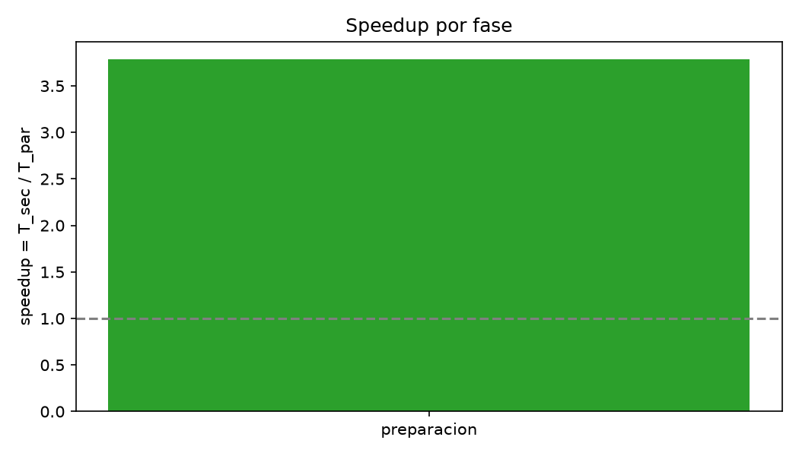
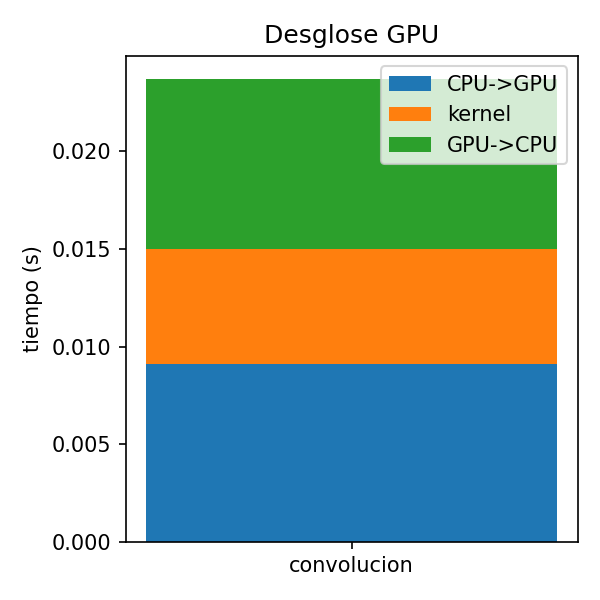
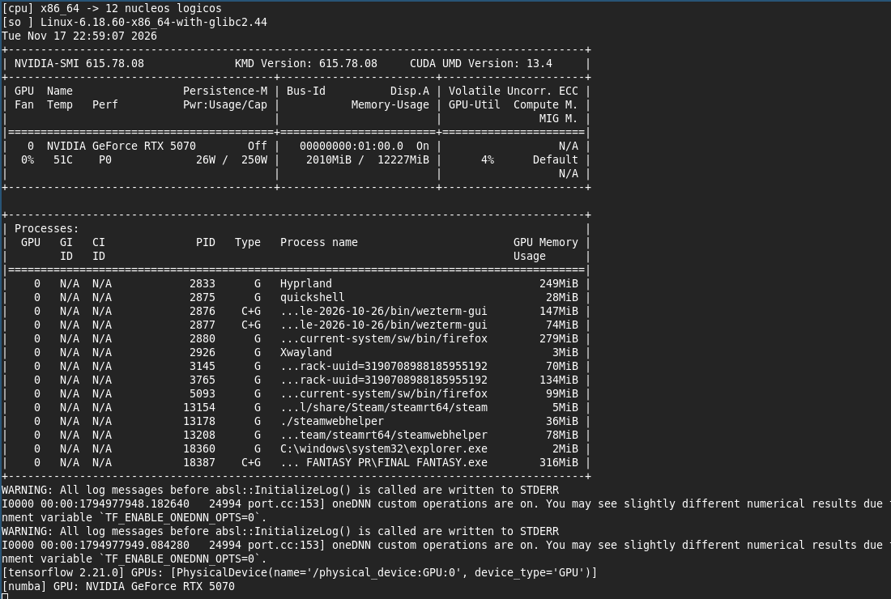
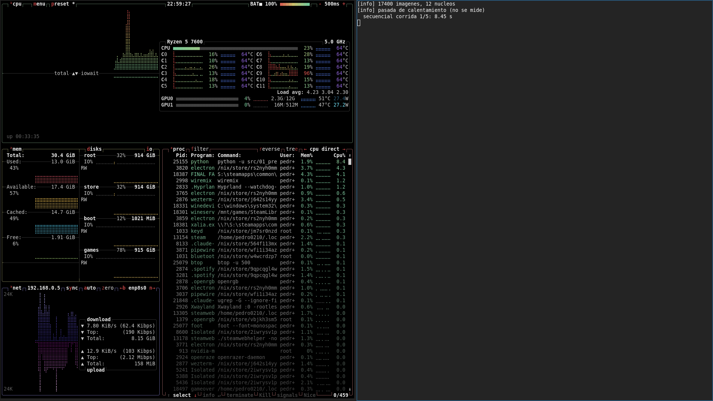
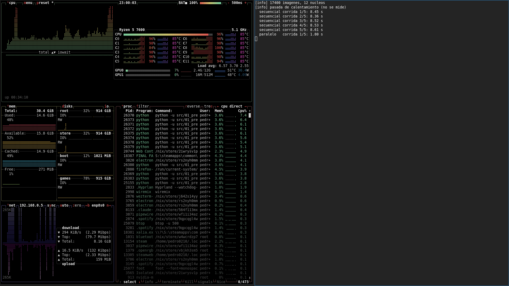
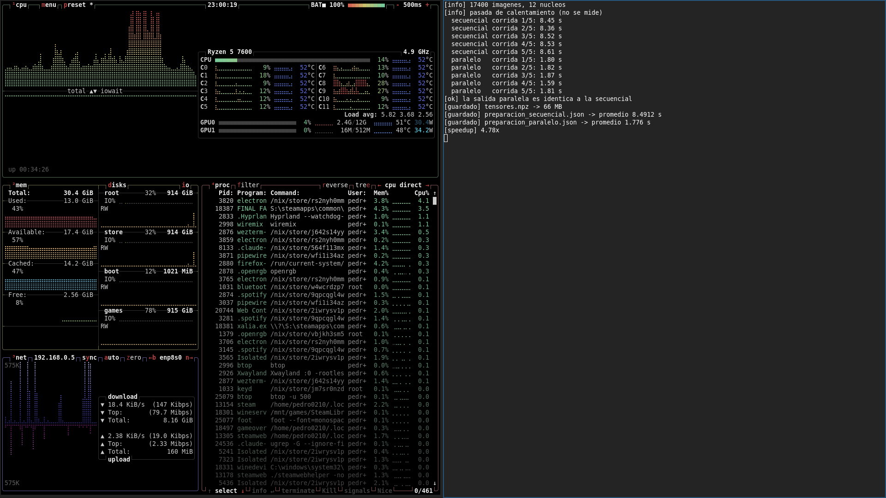
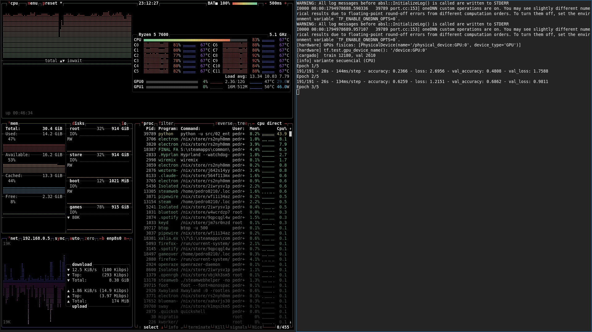
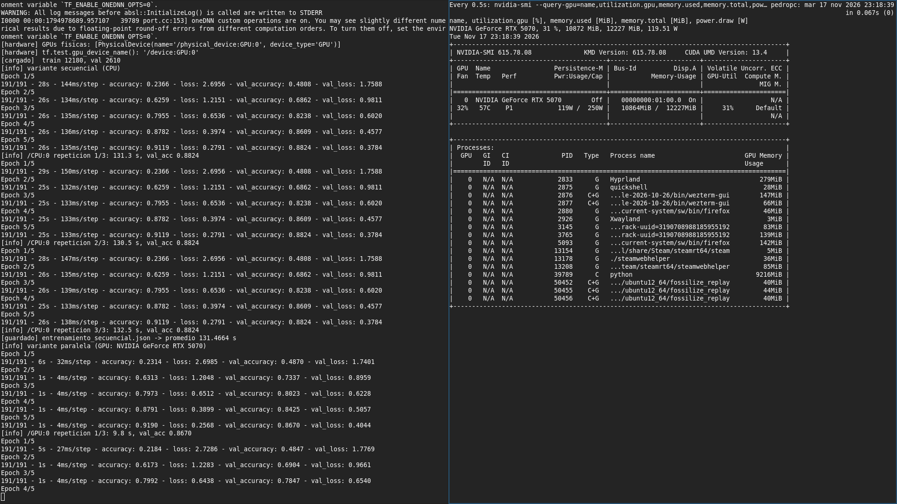
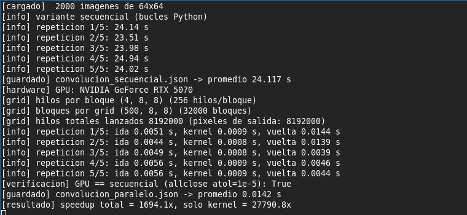

Laboratorio acelerado: *Laboratorio 3. Deep Learning: Reconocimiento de Lenguaje de Señas ASL* (curso de Data Science). Código y resultados: `src/`, `resultados/` y `notebooks/proyecto3_colab.ipynb` del repositorio.

## 1. Análisis de la solución secuencial

El laboratorio original (Laboratorio 3, clasificación de lenguaje de señas ASL) es un pipeline de scripts de Python:

- `01_particiones.py`: lista los jpg del dataset crudo (29 carpetas de 3000 imágenes), toma 600 por clase al azar (semilla 123) y las reparte de forma estratificada en train/val/test (70/15/15). Solo produce un inventario CSV de rutas.
- `02_preprocesamiento.py`: recorre el inventario imagen por imagen, la abre, la pasa a grises, la reescala de 200x200 a 64x64 con LANCZOS y la normaliza a [0, 1]. Guarda los tensores en un `.npz`.
- `03_augmentation.py`: genera copias de entrenamiento con rotación, zoom, desplazamiento, brillo y contraste (sin espejos).
- `modelado.py`: entrena y evalúa modelos Keras (CNN, red densa) y sklearn con un protocolo común (semilla, épocas máximas, EarlyStopping, accuracy en validación).

### Operaciones identificadas (de recibir las imágenes al resultado)

| No. | Operación identificada | Descripción de su funcionamiento |
|---|---|---|
| 1 | Listar archivos | `glob("*.jpg")` por clase; devuelve las rutas ordenadas de las 29 carpetas. |
| 2 | Submuestreo y partición | Elige 600 imágenes por clase sin reemplazo, las baraja y las asigna a train (420), val (90) y test (90). |
| 3 | Abrir JPG | `PIL.Image.open` lee y decodifica el archivo JPEG de 200x200 RGB a memoria. |
| 4 | Conversión a grises | `convert("L")` combina los 3 canales en uno por píxel. |
| 5 | Reescalado LANCZOS | `resize((64, 64), LANCZOS)`: cada píxel de salida es un promedio ponderado de una vecindad de la imagen original. |
| 6 | Normalización | Se divide entre 255 para dejar los píxeles en [0, 1] (float32). |
| 7 | Codificación de etiquetas | La clase (texto) se convierte en un índice entero según `CLASES`. |
| 8 | Apilado de tensores | Cada imagen se escribe en un arreglo `(N, 64, 64, 1)`; se guarda por partición con sus etiquetas. |
| 9 | Aumento de datos | Transformaciones aleatorias por lotes sobre train; se concatenan con los originales. |
| 10 | Convolución (forward) | Cada filtro 3x3 se desliza sobre el mapa de entrada; en cada posición suma productos con los pesos y el sesgo, y aplica ReLU. |
| 11 | Pooling | MaxPool 2x2 reduce a la mitad alto y ancho, quedándose con el máximo de cada ventana. |
| 12 | Capas densas | Flatten y Dense(128): multiplicación matriz-vector/matriz; Dense(29) con softmax produce probabilidades por clase. |
| 13 | Pérdida | Entropía cruzada entre las probabilidades y la etiqueta real. |
| 14 | Retropropagación | Se calculan los gradientes de la pérdida respecto a cada peso, capa por capa hacia atrás. |
| 15 | Actualización de pesos | Adam usa los gradientes para ajustar los pesos en cada lote. |
| 16 | Validación | Se repite el forward sobre val al final de cada época para medir la accuracy. |
| 17 | Predicción | `argmax` sobre las 29 probabilidades da la clase predicha. |

### Operaciones repetitivas y cantidad de repeticiones

Arquitectura del proyecto: 3 x [Conv2D 3x3 (32, 64, 64 filtros) + MaxPool], Flatten, Dense 128, Dense 29. Particiones sin aumento: 29 x 420 = 12,180 train; 29 x 90 = 2,610 val; 2,610 test.

| Operación repetitiva | Datos que procesa | Cantidad de repeticiones |
|---|---|---|
| Preprocesamiento de imagen (abrir, grises, resize, normalizar) | 1 imagen JPG 200x200 | 17,400 (29 x 600) |
| Lotes por época | train | ceil(12,180 / 64) = 191 lotes/época (x 5 épocas = 955 lotes en el benchmark) |
| Convolución capa 1 (1 -> 32 filtros, entrada 64x64) | 1 imagen | 64 x 64 x 32 = 131,072 posiciones de salida; 64x64x32x9x1 = 1,179,648 multiplicaciones-suma |
| Convolución capa 2 (32 -> 64 filtros, entrada 32x32) | 1 imagen | 32 x 32 x 64 = 65,536 posiciones; 32x32x64x9x32 = 18,874,368 mult-suma |
| Convolución capa 3 (64 -> 64 filtros, entrada 16x16) | 1 imagen | 16 x 16 x 64 = 16,384 posiciones; 16x16x64x9x64 = 9,437,184 mult-suma |
| Total convolución | 1 imagen | 29,491,200 mult-suma por imagen en el forward (solo capas conv) |
| Convolución por época (forward, capas conv) | 12,180 imágenes | 12,180 x 29,491,200 = 359,202,816,000 mult-suma (≈3.6e11) |
| Kernel de convolución del proyecto (fase 3) | N imágenes de 64x64 | N x 64 x 64 hilos; para N = 2000: 8,192,000 hilos (cada uno 9 mult-suma) |

Nota: el backward cuesta aproximadamente el doble del forward, por lo que una época completa es varias veces mayor que la cifra anterior.

## 2. Medición secuencial

**Procedimiento.** Cada fase se mide con `time.perf_counter()`, con los mismos datos y la misma semilla (123), y se reporta el promedio y la desviación estándar. Preparación y convolución usan 5 repeticiones; entrenamiento usa 3 (valor por defecto de `02_entrenamiento.py`, porque cada corrida en CPU tarda casi 3 minutos). Los tiempos se guardan en `resultados/<fase>_secuencial.json`. En entrenamiento se fijan 5 épocas para que ambas variantes hagan el mismo trabajo.

| Fase | Tiempo por repetición (s) | Promedio (s) | Desv. est. (s) |
|---|---|---|---|
| Preparación (17,400 imágenes) | 16.49, 17.45, 17.05, 16.94, 17.22 | 17.031 | 0.360 |
| Entrenamiento CPU (5 épocas) | 171.44, 174.50, 165.03 | 170.324 | 4.830 |
| Convolución NumPy (N = 2000) | 46.19, 46.35, 46.38, 46.20, 45.96 | 46.217 | 0.167 |

Equipo 1 (tablas de las secciones 2, 5 y 6): laptop con AMD Ryzen 5 5600H (6 núcleos físicos, 12 lógicos), 16 GB de RAM, Windows 11 Home (nativo, sin WSL).

**Factores que afectan el rendimiento medido:**
- E/S de disco: la lectura de 17,400 archivos depende del disco y de si el sistema los tiene en caché (la primera repetición suele ser más lenta).
- Decodificación JPEG: es trabajo de CPU por imagen y domina el costo de la preparación.
- GIL de Python: los hilos no aceleran código Python puro, por eso se usan procesos.
- Caché de CPU y acceso a memoria en los bucles anidados.
- Thermal throttling: la CPU reduce frecuencia al calentarse en corridas largas.
- Procesos en segundo plano que compiten por CPU y memoria.

## 3. Oportunidades de paralelización

- **Preparación de imágenes (CPU multiproceso).** Cada imagen se procesa de forma independiente (sin dependencias entre ellas), así que es un problema de tareas independientes. El costo es de E/S y decodificación JPEG, trabajo irregular y de control que no se adapta bien a una GPU; se reparte entre todos los núcleos con `multiprocessing.Pool`.
- **Convolución y multiplicación de matrices (GPU).** Son aritmética idéntica repetida sobre millones de elementos (decenas de millones de mult-suma por imagen), con cada posición de salida independiente de las demás. Es el patrón de paralelismo de datos que una GPU ejecuta con miles de hilos simultáneos.
- **Se mantiene secuencial:** el bucle de épocas y lotes (cada actualización de pesos depende de la anterior), el orden de las capas dentro del forward/backward (cada capa necesita la salida de la anterior), la partición y el listado de archivos (costo mínimo) y la escritura final de resultados. Por la ley de Amdahl, estas partes limitan la ganancia máxima.

## 4. Diseño del algoritmo paralelo

**Kernel de convolución (Numba CUDA).** Se usa un hilo por píxel de salida de un volumen `(N, 64, 64)`. Cada hilo obtiene su índice con `cuda.grid(3)` = (imagen, fila, columna), verifica límites (`if i < N and y < 64 and x < 64`) y calcula la suma de 9 productos del filtro 3x3 con relleno "same" (los vecinos fuera de la imagen valen 0).

- Hilos por bloque: (4, 8, 8) = 256.
- Bloques por grid: ceil(dim / tpb) en cada eje. Para N = 2000: (ceil(2000/4), ceil(64/8), ceil(64/8)) = (500, 8, 8) = 32,000 bloques.
- Hilos totales: 32,000 x 256 = 8,192,000 = 2000 x 64 x 64 (uno por píxel, sin hilos sobrantes en este caso). La verificación de límites protege cuando N no es múltiplo de 4.

```
grid = (500, 8, 8) bloques            bloque = (4, 8, 8) hilos
 +----+----+--...--+                  eje0: 4 imagenes
 | b0 | b1 |       |  eje y: 8 bloques    eje1: 8 filas
 +----+----+--...--+  eje x: 8 bloques    eje2: 8 columnas
 ... x 500 en el eje de imagenes          = 256 hilos
hilo (i, y, x) -> salida[i, y, x] = suma de 9 vecinos * filtro
```

**Flujo de datos:** host (NumPy) -> `cuda.to_device` (transferencia CPU->GPU) -> kernel en la GPU -> `copy_to_host` (GPU->CPU). Se miden por separado la ida, el kernel y la vuelta, con `cuda.synchronize()` antes de leer el reloj porque el lanzamiento del kernel es asíncrono.

**Equivalente en TensorFlow/cuDNN.** Al entrenar en `/GPU:0`, TensorFlow envía los tensores del lote a la memoria de la GPU y cada capa se ejecuta con kernels de cuDNN (convolución, pooling) y cuBLAS (capas densas), que usan el mismo principio de hilos/bloques, con algoritmos más optimizados (memoria compartida, Winograd/FFT, Tensor Cores según la GPU). El forward y el backward corren en la GPU y solo regresan métricas al host.

## 5. Implementación y medición paralela

**Cómo ejecutar:** las mediciones de este informe se hicieron en Windows nativo con dos entornos conda (`p3cuda` para las fases 1, 2 y 4; `p3numba` para la fase 3), siguiendo el README. En Linux/NixOS el proyecto completo se configura con `nix develop` (archivo `flake.nix`): crea un solo entorno con TensorFlow 2.21 (`tensorflow[and-cuda]`) y `numba-cuda`, con las librerías CUDA 12 incluidas en las ruedas de pip; se verificó que ambos reconocen una NVIDIA GeForce RTX 5070. También se puede usar `notebooks/proyecto3_colab.ipynb` en Google Colab con GPU T4.

**Librerías y su rol:**
- `multiprocessing` (Pool): reparte las imágenes entre los núcleos de la CPU (fase 1).
- TensorFlow 2.10.1 + CUDA 11.2 + cuDNN 8.1: construye la CNN y la ejecuta en `/CPU:0` o `/GPU:0` (fase 2). Es la última versión de TensorFlow con GPU en Windows nativo.
- Numba CUDA (`numba-cuda` 0.30.4 con librerías de CUDA 12): kernel de convolución escrito a mano con control explícito de hilos, bloques y transferencias (fase 3). Va en un entorno aparte porque el Numba compatible con TensorFlow 2.10 falla con el driver NVIDIA actual.
- NumPy, Pillow, matplotlib: datos, lectura de imágenes y gráficas.

| Fase | Tiempo por repetición (s) | Promedio (s) | Desv. est. (s) |
|---|---|---|---|
| Preparación, Pool de 12 procesos | 4.20, 4.60, 4.50, 4.53, 4.50 | 4.466 | 0.155 |
| Entrenamiento GPU (5 épocas) | 16.37, 16.13, 15.99 | 16.162 | 0.193 |
| Convolución Numba CUDA (N = 2000) | 0.0230, 0.0218, 0.0238, 0.0265, 0.0235 | 0.0237 | 0.002 |

| Convolución CUDA | Tiempo promedio (s) |
|---|---|
| Transferencia CPU -> GPU | 0.0091 |
| Kernel | 0.0059 |
| Transferencia GPU -> CPU | 0.0087 |

La salida del kernel coincide con la versión secuencial (`np.allclose`, atol = 1e-5).

GPU usada (equipo 1): NVIDIA GeForce RTX 3050 Ti Laptop GPU, 4 GB de VRAM, driver 621.01 (`nvidia-smi` reporta CUDA 13.5). Durante el entrenamiento en GPU, `resultados/nvidia_smi_log.csv` registra picos de 89 % de utilización y 3.8 GB de memoria usada (incluye lo que ya ocupaba el escritorio, ≈1.2 GB). Accuracy de validación tras 5 épocas (última repetición): 0.8793 en CPU y 0.8977 en GPU; la diferencia es la variación normal entre corridas, porque las operaciones de cuDNN no son deterministas.

## 6. Análisis y conclusiones

**Tabla comparativa** (`resultados/tabla_comparativa.md`):

| Fase | T secuencial (s) | desv | T paralelo (s) | desv | Speedup |
|---|---|---|---|---|---|
| preparacion | 17.031 | 0.360 | 4.466 | 0.155 | 3.81x |
| entrenamiento | 170.324 | 4.830 | 16.162 | 0.193 | 10.54x |
| convolucion | 46.217 | 0.167 | 0.024 | 0.002 | 1950.09x |







Lectura de los resultados:
- **Preparación (3.81x con 12 procesos):** lejos de 12x porque el equipo tiene 6 núcleos físicos (los otros 6 son SMT), y porque crear los procesos y devolver los arreglos al proceso padre es trabajo secuencial.
- **Entrenamiento (10.54x):** la GPU baja cada época de ≈34 s a ≈3 s. El speedup no es mayor porque el modelo es pequeño y el armado de lotes y el bucle de Keras siguen en la CPU.
- **Convolución (1950x):** la línea base son bucles de Python puro, lentos a propósito, así que la cifra mide tanto el paralelismo como el paso de código interpretado a código compilado. Del tiempo en GPU (23.7 ms), solo 5.9 ms son el kernel; las dos transferencias suman 17.8 ms (75 %). Contando solo el kernel el speedup es ≈7800x.

Speedup: **S = T_secuencial / T_paralelo**. Un valor mayor a 1 indica que la versión paralela es más rápida.

**(a) ¿Por qué procesar imágenes/archivos en varios núcleos de CPU y delegar solo la matemática de la red a la GPU?** Preparar una imagen es leer un archivo, decodificar JPEG y reescalar: mucha E/S y lógica de control, con tareas independientes y de duración irregular. Eso se reparte bien entre unos pocos núcleos potentes de CPU, y una GPU no tiene acceso directo al sistema de archivos ni es eficiente decodificando JPEG. En cambio, la convolución y las multiplicaciones de matrices son la misma operación aritmética sobre millones de datos, que es lo que una GPU hace mejor. Cada procesador se usa para lo que mejor hace, y los tensores ya preparados se envían a la GPU una sola vez.

**(b) ¿Cómo redujo o cambió CUDA el tiempo de procesamiento?** Reducción medida: el entrenamiento pasó de 170.3 s a 16.2 s (10.54x) y la convolución de 2000 imágenes de 46.2 s a 0.024 s (1950x, incluyendo transferencias). Mecanismo: en lugar de calcular una posición de salida tras otra, la GPU lanza miles de hilos que calculan posiciones distintas a la vez, y su ancho de banda de memoria y cantidad de unidades aritméticas son mucho mayores que los de la CPU. En el entrenamiento, cuDNN además usa kernels optimizados. El costo es que aparecen tiempos nuevos (transferencias host-device, lanzamiento) que la versión secuencial no tiene.

**(c) Factores que justifican o limitan el uso de CUDA:**
- Sobrecosto de transferencia: copiar datos por PCIe puede costar más que el cálculo si el trabajo por dato es poco. En la fase 3 las transferencias fueron el 75 % del tiempo en GPU (17.8 ms de 23.7 ms).
- Lotes o problemas pequeños: no ocupan la GPU, y el sobrecosto fijo domina.
- Ley de Amdahl: la parte secuencial (carga de datos, bucle de épocas) acota el speedup total: S <= 1 / ((1 - p) + p/s), con p la fracción paralelizable y s la aceleración de esa fracción.
- VRAM limitada: el conjunto de datos y el modelo deben caber en memoria de la GPU (o procesarse por lotes). En la fase 2 la GPU de 4 GB llegó a 3.8 GB usados.
- Disponibilidad de hardware: requiere una GPU NVIDIA y drivers/toolkit compatibles; en Colab el acceso es limitado. En este equipo la compatibilidad de versiones obligó a usar dos entornos (TensorFlow 2.10 con CUDA 11.2 y Numba con CUDA 12).
- Calentamiento/JIT: la primera llamada incluye inicialización de CUDA y compilación de Numba; por eso las fases 1, 2 y 3 hacen una pasada de calentamiento que no se mide antes de las repeticiones.

## 7. Evidencia de ejecución (segundo equipo)

Para la evidencia con monitores de recursos se repitió el pipeline completo en un segundo equipo, con los mismos scripts, datos, semilla y número de repeticiones. Así las capturas y los tiempos de esta sección corresponden a la misma ejecución.

- **Equipo 2:** AMD Ryzen 5 7600 (6 núcleos físicos, 12 lógicos), 30 GB de RAM, NVIDIA GeForce RTX 5070 (12 GB, driver 615.78.08), NixOS (Linux 6.18).
- **Entorno:** `nix develop` (archivo `flake.nix`) con Python 3.12, TensorFlow 2.21, `numba-cuda` y NumPy 2.3. Es un solo entorno; las librerías CUDA 12 vienen en las ruedas de pip.
- **Procedimiento:** `scripts/capturar_evidencia.sh` ejecuta cada fase en su propia terminal dentro de un compositor Wayland sin monitor (sway headless, 1920x1080). Pone `btop` (uso por núcleo) o `nvidia-smi` (actualizado cada 0.5 s) al lado y toma las capturas con `grim` en momentos fijos de la ejecución. Las salidas completas quedan en `resultados/rtx5070/logs/` y las capturas en `resultados/rtx5070/capturas/`.
- **Condiciones:** el equipo tenía otras aplicaciones abiertas (navegador, Steam). Aparecen en los monitores y explican la carga de fondo de 10–25 % en algunos núcleos.

| Fase (equipo 2) | T secuencial (s) | desv | T paralelo (s) | desv | Speedup |
|---|---|---|---|---|---|
| preparación (1 vs 12 procesos) | 8.491 | 0.095 | 1.776 | 0.107 | 4.78x |
| entrenamiento (CPU vs RTX 5070, 5 épocas) | 131.466 | 1.023 | 9.436 | 0.531 | 13.93x |
| convolución (bucles Python vs kernel CUDA, N = 2000) | 24.117 | 0.516 | 0.014 | 0.005 | 1698x |

Convolución en GPU: transferencia CPU->GPU 5.1 ms, kernel 0.9 ms y GPU->CPU 8.3 ms. Las transferencias son el 94 % del tiempo en GPU; contando solo el kernel, el speedup es ≈27,800x. Las tendencias coinciden con las del equipo 1 (sección 6): todas las fases se aceleran. El entrenamiento gana más con la GPU más grande (13.9x contra 10.5x). En la convolución el kernel es tan corto que el costo lo dominan casi por completo las transferencias por PCIe.

### Hardware reconocido por el entorno

`00_verificar_hardware.py`: `nvidia-smi` identifica la RTX 5070, TensorFlow 2.21 lista `/physical_device:GPU:0` y Numba encuentra la misma GPU.



### Fase 1: preparación en CPU (multiprocessing)

Versión secuencial: un solo núcleo trabaja (C9 al 96 %) y el resto queda en la carga de fondo.



Versión paralela con `Pool` de 12 procesos: los 12 núcleos lógicos suben a 84–100 % (CPU total 96 %) y la lista de procesos muestra los 12 trabajadores `python src/01_preparacion.py`. La GPU sigue en reposo (4–7 %), porque esta fase no la usa.





### Fase 2: entrenamiento CPU vs GPU (CUDA/cuDNN)

Entrenamiento en `/CPU:0`: todos los núcleos al 77–92 %, ≈26 s por época, mientras la GPU queda en reposo (4 %).



Entrenamiento en `/GPU:0` (captura a mitad de una época): `nvidia-smi` muestra el proceso `python` con 9.2 GB de VRAM, la GPU en estado P1 a 119 W y ≈1 s por época. El registro `resultados/rtx5070/nvidia_smi_log.csv` (una muestra por segundo) da un pico de 74 % de utilización y 11.06 GB de 12.2 GB de memoria. La utilización media fue del 21 %, porque el modelo es pequeño y la GPU queda ociosa entre épocas, durante la validación y mientras Keras arma los lotes en la CPU.



### Fase 3: kernel de convolución Numba CUDA

La salida muestra la configuración del grid (bloques de (4, 8, 8) = 256 hilos, grid de (500, 8, 8) = 32,000 bloques, 8,192,000 hilos), los tiempos de transferencia y de kernel por repetición, y la verificación `allclose` contra la versión secuencial. El kernel dura menos de 1 ms, demasiado poco para que aparezca en un muestreo de `nvidia-smi`; la evidencia de esta fase es la salida del programa.


